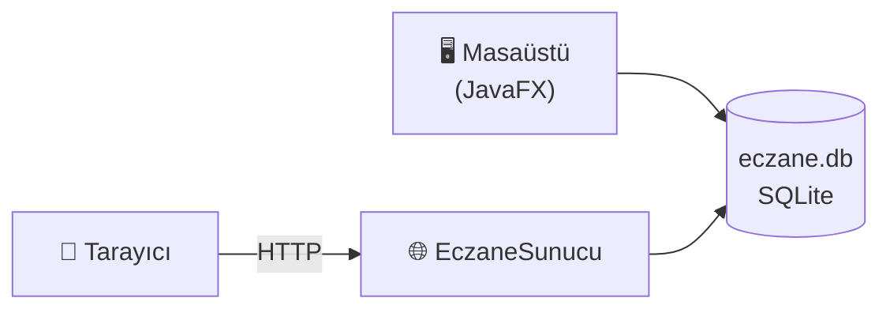

<div align="center">


# Eczane Otomasyon

**Doktor, hasta ve eczacıyı tek sistemde buluşturan reçete, stok ve mesajlaşma uygulaması.**
Masaüstünde JavaFX, tarayıcıda mobil uyumlu web sitesi; ikisi de aynı veritabanını kullanır.


[Hızlı başlangıç](#-hızlı-başlangıç) ·
[Özellikler](#-özellikler) ·
[Web sunucusu](#-web-sunucusu) ·
[Güvenlik](#-güvenlik) ·
[Proje yapısı](#-proje-yapısı)

</div>

---

## 📌 Nedir?

Eski Python/Tkinter sürümünün **Java 25 + JavaFX** ile baştan yazılmış, modernleştirilmiş hâli.
Üç rol vardır ve her biri yalnızca kendi işini görür:

| Rol | Neler yapabilir? |
|---|---|
| 👨‍⚕️ **Doktor** | Hastaya reçete yazar, ilaç adını otomatik tamamlar, bekleyen reçeteyi sebebiyle iptal eder |
| 🧑 **Hasta** | Reçetelerini ve durumlarını izler, eczacı/doktorla mesajlaşır |
| 💊 **Eczacı** | Reçeteyi teslim eder, stok tutar, kritik stokları ve stok hareketlerini izler |

## 🚀 Hızlı başlangıç

**Gerekenler:** JDK 25 veya üstü. Maven kurmana gerek yok, `mvnw` kendini indirir.

```bash
git clone https://github.com/m-enes5812/EczaneOtomasyon.git
cd EczaneOtomasyon
mvnw javafx:run
```

| Ne yapmak istiyorsun? | Komut |
|---|---|
| Masaüstü uygulamasını çalıştır | `mvnw javafx:run` |
| Web sunucusunu çalıştır | `sunucu.cmd` |
| Testleri çalıştır | `mvnw test` |
| Kurulumsuz `.exe` paketi oluştur | `paketle.cmd` |

`paketle.cmd` sonunda `target\dist\EczaneOtomasyon\` klasörü oluşur. İçinde `EczaneOtomasyon.exe`
(masaüstü) ve `EczaneSunucu.exe` (web) vardır. **Java klasörün içinde gelir**, başka bir
bilgisayara kopyalayıp doğrudan açabilirsin.

> **IntelliJ IDEA:** *File → Open → `pom.xml`*, ardından `com.eczane.Launcher` sınıfını çalıştır.

## ✨ Özellikler

### Arayüz
- Modern, sade tasarım (AtlantaFX), **açık/koyu tema**, kenar menüsü, ikonlar, bildirimler.
- Role özel **Genel Bakış**: sayaçlar, son reçeteler, kritik stoklar.
- Reçeteler **ana-detay** düzeninde: arama, durum filtresi, ilaç tablosu ve **sohbet balonları** tek ekranda.
- Sohbet 5 saniyede, okunmamış mesaj sayısı 10 saniyede bir kendiliğinden yenilenir.
- Pencere hiç donmaz: veritabanı ve şifre işlemleri arka planda çalışır.

### Doktor
- Hasta T.C. girilince hasta adı anında doğrulanır.
- İlaç adı otomatik tamamlama, hazır kullanım talimatları, aynı ilacın tekrarını birleştirme.
- Bekleyen reçeteyi sebep belirterek iptal etme.

### Eczacı
- Teslim ekranında her ilacın stokta olup olmadığı tek bakışta görünür.
- Teslim **tek bir transaction** hâlinde yapılır: ya hepsi ya hiçbiri. Aynı reçete iki kez verilemez.
- Stok giriş/çıkışı sebebiyle kaydedilir, stok sıfırın altına düşemez.
- İlaç başına **kritik seviye** ve **stok hareketleri** geçmişi (kim, ne zaman, neden).
- Kayıtta yeni eczane ekleme; elle ya da her gün otomatik **yedek**.

## 🌐 Web sunucusu

Programı telefon, tablet ya da başka bir bilgisayardan tarayıcıyla da kullanabilirsin.
Sunucu ek kütüphane gerektirmez, JDK'nın yerleşik HTTP sunucusuyla çalışır.

| Ne yapmak istiyorsun? | Komut |
|---|---|
| Sunucuyu başlat (hazır paket) | `EczaneSunucu.exe` |
| Sunucuyu başlat (geliştirirken) | `sunucu.cmd` |
| Farklı port | `EczaneSunucu.exe --port 8081` |
| Yalnızca bu bilgisayardan erişim | `EczaneSunucu.exe --host 127.0.0.1` |

Sunucu açılınca adresleri yazar:

- Bu bilgisayardan: **http://localhost:8080**
- Aynı Wi-Fi'daki cihazlardan: **http://192.168.x.x:8080**

İlk açılışta Windows Güvenlik Duvarı sorarsa **"Özel ağlar"** için izin ver.



**Masaüstü ve web aynı veritabanını kullanır:** masaüstünde yazılan reçete web'de, web'de gönderilen
mesaj masaüstünde görünür. İkisi aynı anda açık olabilir. Sunucu her saat başı günlük yedeği kontrol eder.

Web sitesinde tanıtım sayfası, giriş / kayıt / şifremi unuttum, genel bakış, reçete listesi + detay + sohbet,
yeni reçete, stok ve stok hareketleri, hesap ayarları, açık/koyu tema ve mobil uyumlu düzen bulunur.
Ana ekrana eklenebilir (PWA).

> [!WARNING]
> Sunucu düz HTTP ile çalışır; yalnızca güvendiğin yerel ağda kullan. İnternete açmak istersen önüne
> HTTPS sağlayan bir ters vekil (Caddy, nginx) ya da Cloudflare Tunnel koy; çerezler otomatik olarak `Secure` olur.

## 🔒 Güvenlik

| Alan | Önlem |
|---|---|
| Şifreler | PBKDF2-HMAC-SHA256, 600.000 tekrar, sabit süreli karşılaştırma |
| Şifre kuralı | En az 8 karakter, harf + rakam, güç göstergesi |
| Kaba kuvvet | Hatalı denemede artan kilit: 3 deneme → 1 dk, sonra 2 dk, 4 dk… |
| Kimlik | Resmi **T.C. Kimlik No algoritmasıyla** doğrulama |
| Yetki | Tüm kontroller servis katmanında; başkasının reçetesine erişilemez |
| Veritabanı | Parametreli SQL, döner günlük dosyaları |
| Web oturumu | Sunucu tarafı oturum, `HttpOnly` + `SameSite=Strict` çerez, CSRF koruması, sıkı CSP |
| Oturum süresi | 2 saat işlem yoksa kapanır; şifre değişince diğer cihazlardaki oturumlar kapanır |

## 💾 Veriler ve eski sürümden geçiş

Veriler `%LOCALAPPDATA%\EczaneOtomasyon` altında tutulur (`eczane.db`, `logs\`, `yedekler\`).
Farklı bir klasör için `ECZANE_HOME` ortam değişkenini ayarla.

İlk açılışta veritabanı yoksa program **"Eski veritabanını aktar…"** seçeneği sunar. Python sürümünün
`eczane.db` dosyasını seçmen yeterli:

- Tüm kullanıcılar, reçeteler, stoklar ve mesajlar korunur.
- Hesaplar **aynı şifreyle** giriş yapar (PBKDF2 biçimi birebir uyumlu). Düz metin kalmış eski şifreler
  ilk girişte otomatik olarak güvenli biçime çevrilir.
- Şema yalnızca genişletilir (yeni tablo/sütun); hiçbir veri silinmez.

## 🗂️ Proje yapısı

```
src/main/java/com/eczane
├── Launcher.java          giriş noktası
├── config/                veri klasörü, günlük ayarı
├── db/                    SQLite bağlantısı, şema sürümleri (migrations)
├── model/                 kayıt (record) sınıfları
├── repo/                  SQL sorguları
├── security/              şifre özeti, T.C. doğrulama, deneme sınırı
├── service/               iş kuralları ve yetki kontrolleri
├── ui/                    JavaFX arayüzü (views/, components/, app.css)
└── web/                   web sunucusu (API, oturumlar, JSON)
src/main/resources/com/eczane/web   web sitesi (HTML, CSS, JS, PWA)
src/test/java                       birim, akış ve sunucu testleri (22 test)
```

## 🧰 Kullanılan teknolojiler

**Java 25** · **JavaFX 27** · **AtlantaFX 2.1** · **Ikonli** (Material Design 2) · **SQLite JDBC 3.54** ·
**JUnit 6** · **jpackage** (kurulumsuz Windows paketi)
